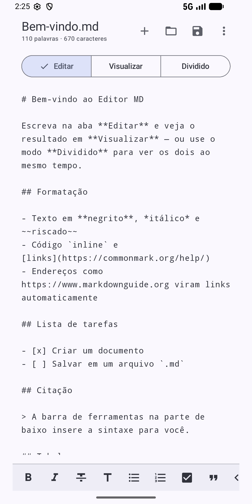
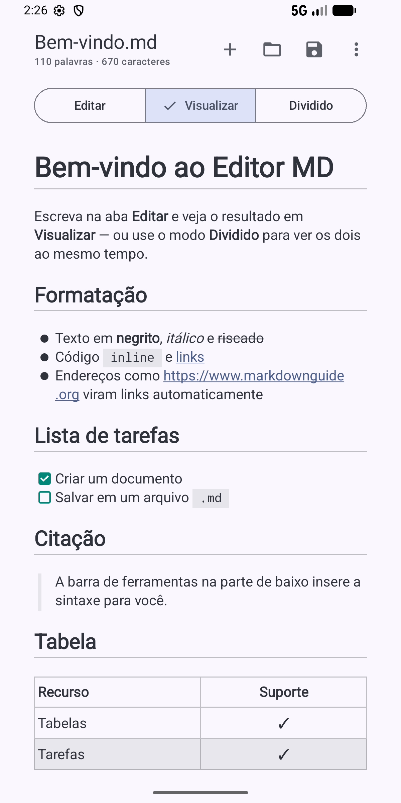
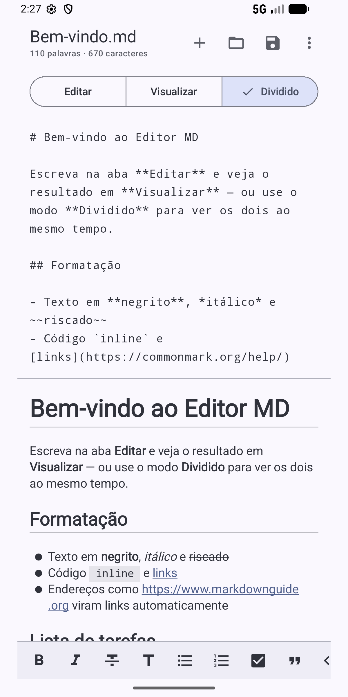

# Editor MD

Editor de Markdown para Android: escreva e visualize o resultado formatado na hora.

<p align="center">
  
  
  
</p>

## Recursos

- Modos **Editar**, **Visualizar** e **Dividido** (lado a lado no modo paisagem)
- Barra de formatação: negrito, itálico, riscado, títulos, listas, tarefas, citação, código, link, tabela e linha horizontal
- Renderização com tabelas, listas de tarefas, texto riscado e links automáticos ([Markwon](https://github.com/noties/Markwon))
- Abrir, salvar e "salvar como" pelo seletor de arquivos do Android; abre arquivos `.md` de outros apps
- Rascunho automático, contador de palavras, compartilhamento e tema claro/escuro com cores dinâmicas
- Sem anúncios, sem coleta de dados e sem acesso à internet — veja a [política de privacidade](docs/privacy-policy.html)

## Tecnologias

Kotlin · Jetpack Compose · Material 3 · Markwon · minSdk 26 · targetSdk 36

## Como compilar

Requer o Android Studio (ou JDK 17+ e o Android SDK).

```bash
./gradlew assembleDebug        # APK de depuração
./gradlew installDebug         # instala no aparelho/emulador conectado
```

### Build de release (Play Store)

Crie um `keystore.properties` na raiz (não versionado):

```properties
storeFile=C:/caminho/para/upload-key.jks
storePassword=...
keyAlias=upload
keyPassword=...
```

E gere o pacote:

```bash
./gradlew bundleRelease        # app/build/outputs/bundle/release/app-release.aab
```

## Estrutura

```
app/src/main/java/br/com/gustavofriedrich/editormd/
├── MainActivity.kt          # ponto de entrada e intents de abertura de arquivos
├── EditorViewModel.kt       # estado do documento, abrir/salvar, rascunho
├── MarkdownFormatter.kt     # ações da barra de formatação
└── ui/
    ├── EditorScreen.kt      # tela principal
    ├── MarkdownPreview.kt   # pré-visualização com Markwon
    └── theme/Theme.kt
docs/privacy-policy.html     # política de privacidade (GitHub Pages)
play-store/                  # ícone, recurso gráfico, capturas e textos da loja
```
